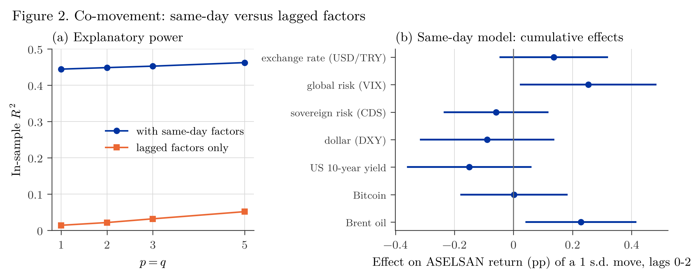
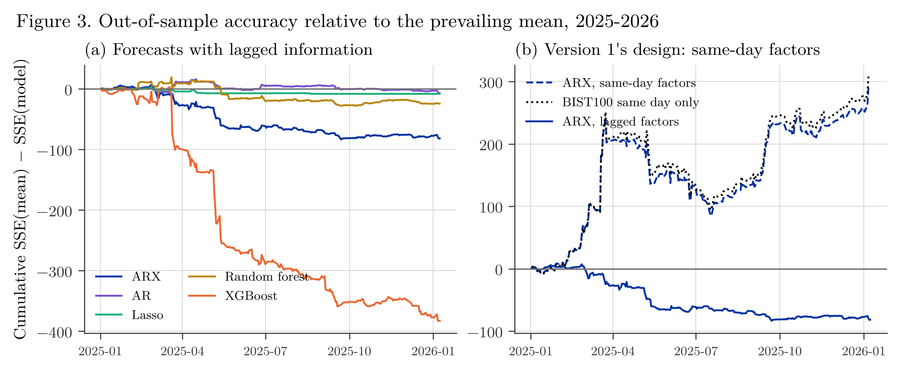

# Return Dynamics of ASELSAN under Global and Sovereign Risk Factors

[](https://github.com/mikbalyilmaz/Return-Dynamics-of-ASELSAN-under-Global-and-Sovereign-Risk-Factors/actions/workflows/tests.yml)
[](LICENSE)

Version 2 of a study of the daily return of ASELSAN (ASELS, Borsa Istanbul) against eight factors: BIST100, USD/TRY,
Bitcoin, Brent oil, VIX, the dollar index, the US 10-year yield and Turkey's 5-year sovereign CDS spread. The ARX
model of version 1 (own lags and factor lags 0 to 2, OLS with Newey–West standard errors) is kept, and two questions
are separated:

1. **Co-movement:** how does ASELSAN move with the factors on the same day?
2. **Forecasting:** can its return be forecast one day ahead, using only what is known at the previous close?

Forecasts are recursive (expanding window, refitted every day) and are compared with the prevailing mean using the
out-of-sample $R^2$, Diebold–Mariano (with the Harvey–Leybourne–Newbold correction), Clark–West and
Pesaran–Timmermann tests. A short project note explains each analysis and writes out the mathematics behind it.



## Contents

| Path | What it is |
|---|---|
| `aselsan/data.py` | Frozen data, alignment of the series on ASELSAN trading days (as of the latest close, nothing filled backwards), transformations |
| `aselsan/models.py` | ARX designs with same-day (lag 0) or lagged factors, Newey–West estimation, joint and cumulative Wald tests |
| `aselsan/forecast.py` | Recursive one-day-ahead forecasts (zero, prevailing mean, random walk, AR, ARX, Ridge, Lasso, random forest, XGBoost) and their evaluation |
| `aselsan/legacy.py` | Runs the code of version 1 from `legacy/main_v1.ipynb` on the frozen data, for comparison |
| `data/` | Yahoo Finance closes downloaded once (`fetch_yahoo.py`, `yahoo_close.csv`, `yahoo_meta.json`) and the CDS file of version 1 |
| `tests/run_tests.py` | Unit tests against a direct search, a hand-written Newey–West covariance, statsmodels, perturbation of future data, simulations with a known answer and the printed output of version 1 |
| `analysis/01_data.py` | The data, the alignment and version 1 reproduced (Figure 1) |
| `analysis/02_comovement.py` | The same-day ARX model: channels tested jointly, cumulative effects, robustness grid of version 1 (Figure 2) |
| `analysis/03_forecast.py` | One-day-ahead forecasts with lagged information, and the same-day design of version 1 for comparison (Figure 3) |
| `analysis/run_all.py` | Runs the three analyses in order (about 20 minutes on two cores; the daily refits of the tree models take most of it) |
| `figures/` | Figures as PNG (300 dpi) and PDF, every reported table as CSV, all forecasts in `forecasts.csv` |
| `paper/aselsan_note.pdf` | Project note; `make_paper.py` writes all its numbers from `figures/*.csv` |
| `legacy/` | Version 1 (notebook, README and reference list), unchanged |
| `fonts/` | Latin Modern Roman (GUST Font License) |

## How to run

```
pip install -r requirements.txt
python tests/run_tests.py
cd analysis
python run_all.py
cd ../paper
python make_paper.py
xelatex aselsan_note.tex && xelatex aselsan_note.tex       # needs XeLaTeX
```

The analyses use the stored data and fixed seeds, so every number is the same at every run. To download the Yahoo
series again: `pip install yfinance`, then `python data/fetch_yahoo.py` (later downloads may differ slightly, because
Yahoo revises adjusted prices).

## Usage

```python
from aselsan.data import asof_panel, transform
from aselsan.models import design, fit_hac, joint_test
from aselsan.forecast import recursive, oos_r2

levels, age = asof_panel()                       # one row per ASELSAN day, each series as of its latest close
trans = transform(levels)                        # 100 x log returns and first differences
y, X = design(trans, p=2, q=2, first_lag=0)      # model of version 1: factors at lags 0..2
res = fit_hac(y, X, hac_lags=5)
joint_test(res, ["r_USDTRY_L0", "r_USDTRY_L1", "r_USDTRY_L2"])     # (chi2, df, p)

y, X = design(trans, p=2, q=2, first_lag=1)      # forecasting design: only lags 1..2
f = recursive(y, X, "2025-01-01", ["Prevailing mean", "ARX"])
oos_r2(f["Realized"], f["ARX"], f["Prevailing mean"])
```

## Main results

- **Co-movement.** ASELSAN's same-day market coefficient is 1.049 and the ARX model of version 1 has $R^2 = 0.448$.
  Without the same-day terms $R^2$ falls to 0.021. Tested jointly, the exchange-rate channel is significant
  ($p = 0.034$); the cumulative three-day responses to VIX and Brent are positive ($p = 0.030$ and $0.015$); CDS
  changes are not significant in the baseline ($p = 0.31$ jointly).
- **Forecasting.** With information up to the previous close, no model beats the prevailing mean over the 256 test
  days from 2 January 2025 to 8 January 2026: $R^2_{OS}$ is $-0.044$ for ARX, between $-0.005$ and $-0.004$ for AR,
  Ridge and Lasso, $-0.013$ for the random forest and $-0.205$ for XGBoost. Clark–West finds no gain from the factors
  ($p = 0.90$).
- **Where version 1's accuracy came from.** With the same-day factors of version 1, $R^2_{OS} = 0.154$ and
  directional accuracy is 65.1%; the same-day BIST100 return alone gives $R^2_{OS} = 0.164$. These measure how well
  the return is explained after the day is over, not how well it can be forecast.

All numbers are in `figures/*.csv` and in the project note.



## Data

Yahoo Finance: ASELS.IS, XU100.IS, TRY=X, BTC-USD, BZ=F, ^VIX, DX-Y.NYB, ^TNX, downloaded once (see
`data/yahoo_meta.json`). Turkey 5-year sovereign CDS (basis points): the file of version 1, 1 January 2020 to
8 January 2026; its source was not recorded (most likely Investing.com). The panel ends on 8 January 2026, the last
date of the CDS file.

## Changes from version 1

See [NEWS.md](NEWS.md): what was added and a table of the corrections to version 1.

## Citation

See [CITATION.cff](CITATION.cff), or:

> Yılmaz, M. İ. (2026). *Return Dynamics of ASELSAN under Global and Sovereign Risk Factors* (Version 2.0.0)
> [Computer software]. https://github.com/mikbalyilmaz/Return-Dynamics-of-ASELSAN-under-Global-and-Sovereign-Risk-Factors

This project is for academic purposes and is not investment advice.

## License

MIT, see [LICENSE](LICENSE).
