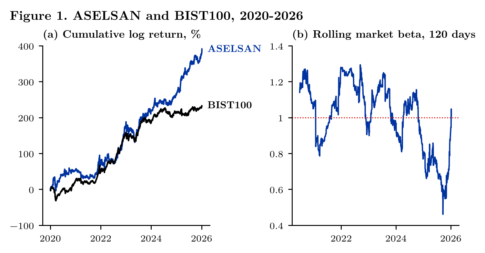

# Return Dynamics of ASELSAN under Global and Sovereign Risk Factors

[](https://github.com/mikbalyilmaz/Return-Dynamics-of-ASELSAN-under-Global-and-Sovereign-Risk-Factors/actions/workflows/tests.yml)
[](LICENSE)

Version 2 of a study of the daily return of ASELSAN (ASELS, Borsa Istanbul) against eight factors: BIST100, USD/TRY,
Bitcoin, Brent oil, VIX, the dollar index (DXY), the US 10-year yield and Turkey's 5-year sovereign CDS spread. The
ARX model of version 1 (own lags and factor lags 0 to 2, OLS with Newey–West standard errors) is kept, and two
questions that version 1 treated as one are separated:

1. **Co-movement:** how does ASELSAN move with the factors on the same day?
2. **Forecasting:** can its return be forecast one day ahead, using only what is known at the previous close?

The project note, [`paper/aselsan_note.pdf`](paper/aselsan_note.pdf), explains each analysis and writes out the
mathematics behind it.

## Data

- **Yahoo Finance:** ASELS.IS, XU100.IS, TRY=X, BTC-USD, BZ=F, ^VIX, DX-Y.NYB and ^TNX, downloaded once and stored in
  `data/` (download date and software versions in `data/yahoo_meta.json`).
- **Turkey 5-year sovereign CDS (basis points):** the file of version 1, 1 January 2020 to 8 January 2026. Its source
  was not recorded; it is most likely Investing.com.
- **Alignment:** one row per ASELSAN trading day; every other series enters with its latest close on or before that
  day, and nothing is filled backwards. The panel runs from 2 January 2020 to 8 January 2026 (1,507 days) and ends on
  the last date of the CDS file.

**Figure 1.** (a) Cumulative log returns (sum of daily log returns, in per cent): ASELSAN 391, BIST100 234.
(b) ASELSAN's market beta over the previous 120 days, which moves between 0.46 and 1.29.



## Main results

### 1. Co-movement on the same day

The ARX model of version 1 is reproduced: market coefficient 1.049, $R^2 = 0.448$. Almost all of this fit comes from
the same day: without the same-day terms $R^2$ falls to 0.021. Tested jointly, the exchange-rate channel is
significant ($p = 0.034$); the cumulative three-day responses to VIX and Brent are positive ($p = 0.030$ and $0.015$);
CDS changes are not significant ($p = 0.31$ jointly).

**Figure 2.** (a) In-sample $R^2$ with and without the same-day factors, for 1, 2, 3 and 5 lags. (b) Effect of a
one-standard-deviation move of each factor on ASELSAN's return over three days (same day and the next two), with 95%
intervals; an interval that crosses zero is not significant.


### 2. One-day-ahead forecasts

Every model is refitted every day on all earlier days and compared with the prevailing (historical) mean, using the
out-of-sample $R^2$, Diebold–Mariano (with the Harvey–Leybourne–Newbold correction), Clark–West and
Pesaran–Timmermann tests. Test sample: the 256 trading days from 2 January 2025 to 8 January 2026.

- **With information up to the previous close, no model beats the prevailing mean.** $R^2_{OS}$ is $-0.044$ for ARX,
  between $-0.005$ and $-0.004$ for AR, Ridge and Lasso, $-0.013$ for the random forest and $-0.205$ for XGBoost.
  Clark–West finds no gain from the factors ($p = 0.90$).
- **Where version 1's accuracy came from.** Version 1 used the factors of the forecast day itself. With these
  same-day factors $R^2_{OS} = 0.154$ and directional accuracy is 65.1%; the same-day BIST100 return alone gives
  $R^2_{OS} = 0.164$. These measure how well the return is explained after the day is over, not how well it can be
  forecast.

**Figure 3.** Cumulative squared error of the prevailing mean minus that of each model: a rising line means the model
is doing better than the mean. (a) Forecasts with information up to the previous close. (b) Version 1's design with
same-day factors.


All numbers are in `figures/*.csv` and in the project note.

## Contents

| Path | What it is |
|---|---|
| `aselsan/data.py` | Frozen data, alignment on ASELSAN trading days, transformations |
| `aselsan/models.py` | ARX designs with same-day or lagged factors, Newey–West estimation, joint and cumulative Wald tests |
| `aselsan/forecast.py` | Recursive one-day-ahead forecasts (zero, prevailing mean, random walk, AR, ARX, Ridge, Lasso, random forest, XGBoost) and their evaluation |
| `aselsan/legacy.py` | Runs the code of version 1 from `legacy/main_v1.ipynb` on the frozen data, for comparison |
| `data/` | Yahoo Finance closes (`fetch_yahoo.py`, `yahoo_close.csv`, `yahoo_meta.json`) and the CDS file of version 1 |
| `tests/run_tests.py` | Unit tests against independent computations and the printed output of version 1 |
| `analysis/01_data.py` | The data, the alignment and version 1 reproduced (Figure 1) |
| `analysis/02_comovement.py` | The same-day ARX model: channels tested jointly, cumulative effects, robustness grid of version 1 (Figure 2) |
| `analysis/03_forecast.py` | One-day-ahead forecasts, and the same-day design of version 1 for comparison (Figure 3) |
| `analysis/run_all.py` | Runs the three analyses in order (about 20 minutes on two cores) |
| `figures/` | Figures as PNG (300 dpi) and PDF, every reported table as CSV, all forecasts in `forecasts.csv` |
| `paper/` | Project note; `make_paper.py` writes all its numbers from `figures/*.csv` |
| `legacy/` | Version 1 (notebook, README and reference list), unchanged |
| `fonts/` | Latin Modern Roman (GUST Font License) |

## How to run

```
pip install -r requirements.txt
python tests/run_tests.py
cd analysis
python run_all.py
cd ../paper
python make_paper.py
xelatex aselsan_note.tex && xelatex aselsan_note.tex       # needs XeLaTeX
```

The analyses use the stored data and fixed seeds, so every number is the same at every run. To download the Yahoo
series again: `pip install yfinance`, then `python data/fetch_yahoo.py` (later downloads may differ slightly, because
Yahoo revises adjusted prices).

## Usage

```python
from aselsan.data import asof_panel, transform
from aselsan.models import design, fit_hac, joint_test
from aselsan.forecast import recursive, oos_r2

levels, age = asof_panel()                       # one row per ASELSAN day, each series as of its latest close
trans = transform(levels)                        # 100 x log returns and first differences
y, X = design(trans, p=2, q=2, first_lag=0)      # model of version 1: factors at lags 0..2
res = fit_hac(y, X, hac_lags=5)
joint_test(res, ["r_USDTRY_L0", "r_USDTRY_L1", "r_USDTRY_L2"])     # (chi2, df, p)

y, X = design(trans, p=2, q=2, first_lag=1)      # forecasting design: only lags 1..2
f = recursive(y, X, "2025-01-01", ["Prevailing mean", "ARX"])
oos_r2(f["Realized"], f["ARX"], f["Prevailing mean"])
```

## Changes from version 1

See [NEWS.md](NEWS.md): what was added and a table of the corrections to version 1.

## Citation

See [CITATION.cff](CITATION.cff), or:

> Yılmaz, M. İ. (2026). *Return Dynamics of ASELSAN under Global and Sovereign Risk Factors* (Version 2.1.0)
> [Computer software]. https://github.com/mikbalyilmaz/Return-Dynamics-of-ASELSAN-under-Global-and-Sovereign-Risk-Factors

This project is for academic purposes and is not investment advice.

## License

MIT, see [LICENSE](LICENSE).